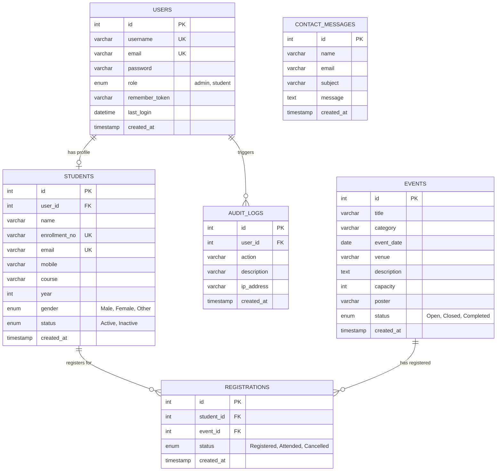

# StudentHub Portal - ER Model & Schema Design
**CHAROTAR UNIVERSITY OF SCIENCE AND TECHNOLOGY (CHARUSAT)**  
**Faculty of Technology and Engineering (FTE / CSPIT)**  
**Subject:** Web Development Frameworks (AIUE203) — Practical 8

---

## 1. Entity-Relationship (ER) Diagram

---

## 2. Schema Normalization Analysis (1NF, 2NF, 3NF)

1. **First Normal Form (1NF):**
   - Each column contains atomic (indivisible) values.
   - No repeating groups or arrays stored in single attributes.
   - Every table has a clearly defined Primary Key (`id` Auto-Increment).

2. **Second Normal Form (2NF):**
   - In 1NF.
   - All non-key attributes are fully functionally dependent on the primary key.
   - In the `registrations` junction table, the primary key is `id`, with a composite unique constraint `(student_id, event_id)` preventing partial dependencies.

3. **Third Normal Form (3NF):**
   - In 2NF.
   - No transitive dependencies (no non-key attribute depends on another non-key attribute).
   - User credentials reside strictly in `users`, academic records in `students`, event metadata in `events`, and audit activities in `audit_logs`.

---

## 3. Referential Integrity & Constraints

- `students.user_id -> users.id`: `ON DELETE SET NULL`
- `registrations.student_id -> students.id`: `ON DELETE CASCADE`
- `registrations.event_id -> events.id`: `ON DELETE CASCADE`
- `audit_logs.user_id -> users.id`: `ON DELETE SET NULL`
- Composite Unique Constraint: `registrations(student_id, event_id)` enforces single registration per event.
