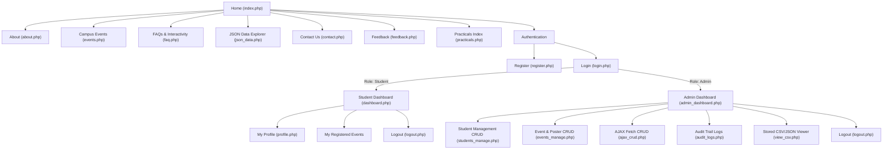

# StudentHub Portal - Sitemap & Navigation Flow
**CHAROTAR UNIVERSITY OF SCIENCE AND TECHNOLOGY (CHARUSAT)**  
**Faculty of Technology and Engineering (FTE / CSPIT)**  
**Subject:** Web Development Frameworks (AIUE203) — Semester 3 (ODD 2026-27)  
**Student ID:** 23DCS089 (AI & ML)

---

## 1. User Roles & Permission Matrix

| Module / Page | Guest | Registered Student | Administrator |
| :--- | :---: | :---: | :---: |
| Home (`index.php`) | Read | Read | Read |
| About Us (`about.php`) | Read | Read | Read |
| Campus Events (`events.php`) | Read | Read & Self-Register | Read, Register & Manage |
| FAQ (`faq.php`) | Read & Search | Read & Search | Read & Search |
| JSON Data View (`json_data.php`) | Read & Filter | Read & Filter | Read & Filter |
| Contact Us (`contact.php`) | Submit Inquiry | Submit Inquiry | Submit & Review |
| Feedback (`feedback.php`) | Submit | Submit | Submit & Review |
| Register (`register.php`) | Access | Redirect to Dash | Redirect to Dash |
| Login (`login.php`) | Access | Redirect to Dash | Redirect to Dash |
| Student Dashboard (`dashboard.php`) | ❌ Blocked | Full Access | Redirect to Admin Dash |
| Student Profile (`profile.php`) | ❌ Blocked | Full Access | Read / Edit |
| Admin Dashboard (`admin_dashboard.php`) | ❌ Blocked | ❌ Blocked (403) | Full Access |
| Student CRUD (`students_manage.php`) | ❌ Blocked | ❌ Blocked (403) | Full Access (Add/Edit/Delete/CSV) |
| Event & Poster CRUD (`events_manage.php`) | ❌ Blocked | ❌ Blocked (403) | Full Access (Upload/CRUD) |
| AJAX No-Reload CRUD (`ajax_crud.php`) | ❌ Blocked | ❌ Blocked (403) | Full Access |
| Audit Trail Logs (`audit_logs.php`) | ❌ Blocked | ❌ Blocked (403) | Full Access |
| Stored Submissions (`view_csv.php`) | ❌ Blocked | ❌ Blocked (403) | Full Access |

---

## 2. Navigation Sitemap Hierarchy

---

## 3. URL Route Specifications

| Route | HTTP Method | Target Script | Description |
| :--- | :---: | :--- | :--- |
| `/` or `/index.php` | GET | `index.php` | Public homepage with hero slider and event cards |
| `/practicals.php` | GET | `practicals.php` | Complete Practicals 1 to 15 directory and evaluation links |
| `/about.php` | GET | `about.php` | Accessible semantic About page with W3C compliance |
| `/events.php` | GET / POST | `events.php` | Browse campus events and submit event participation |
| `/faq.php` | GET | `faq.php` | Collapsible FAQ, theme switcher and modal dialogs |
| `/json_data.php` | GET | `json_data.php` | Consumes `events.json`, `students.json`, `faqs.json` via Fetch API |
| `/contact.php` | GET / POST | `contact.php` | Form validation and CSV file append |
| `/register.php` | GET / POST | `register.php` | Client regex validation + password_hash MySQL insert |
| `/login.php` | GET / POST | `login.php` | Secure login, session regeneration, remember-me token |
| `/logout.php` | GET | `logout.php` | Destroys session, unsets cookies, redirects to login |
| `/dashboard.php` | GET / POST | `dashboard.php` | Student self-service dashboard (registered events) |
| `/profile.php` | GET | `profile.php` | Academic profile view |
| `/admin_dashboard.php` | GET | `admin_dashboard.php` | Admin system metrics and latest registrations |
| `/students_manage.php` | GET / POST | `students_manage.php` | Student CRUD, course filter, search, CSV export |
| `/events_manage.php` | GET / POST | `events_manage.php` | Event CRUD with validated poster uploads |
| `/ajax_crud.php` | GET | `ajax_crud.php` | SPA asynchronous CRUD using Fetch API |
| `/api/events.php` | GET/POST/PUT/DELETE | `api/events.php` | RESTful JSON API endpoint |
| `/audit_logs.php` | GET | `audit_logs.php` | Security audit trail viewer |
| `/view_csv.php` | GET | `view_csv.php` | Displays stored CSV & JSON submissions |
